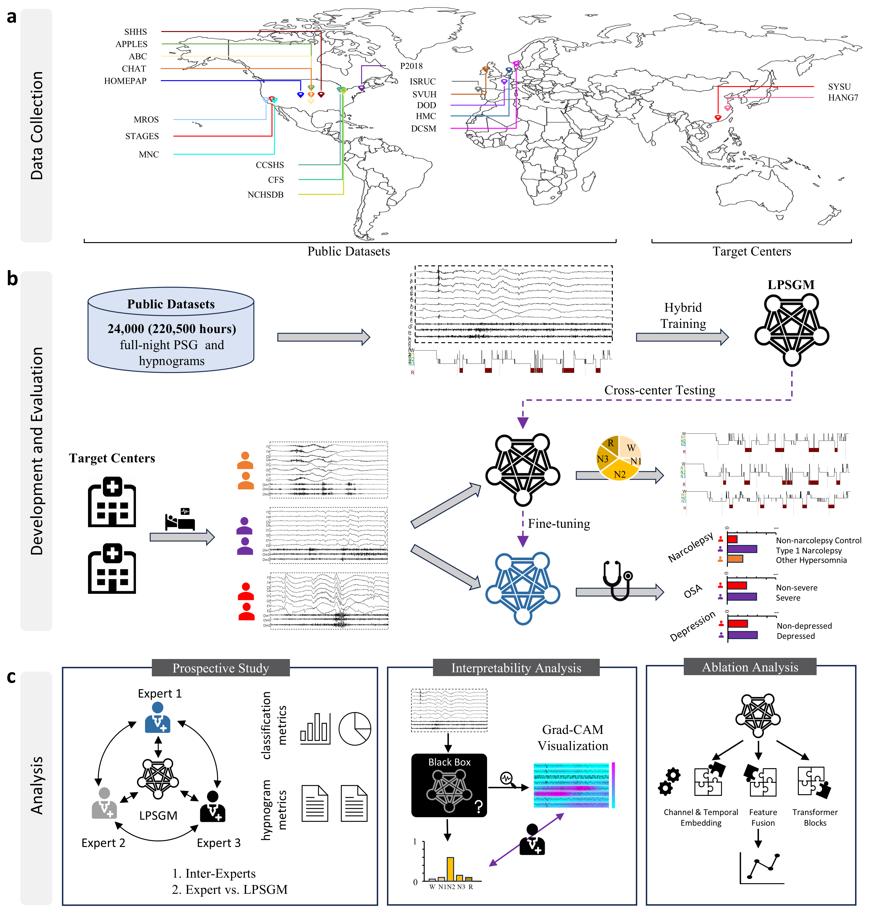
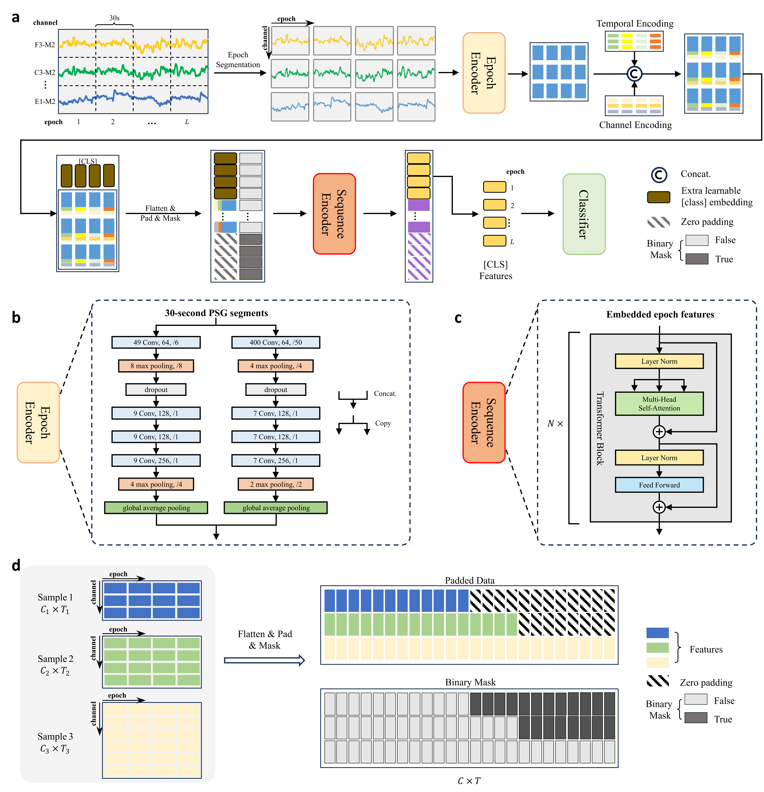

# LPSGM: A Unified Flexible Large Polysomnography Model for Sleep Staging and Downstream Clinical Screening

## Overview



**Figure 1**: Overview of the LPSGM framework. Panel (a): Data harmonization schematizes the aggregation of PSG data from 16 public datasets (220,500 hours), the public MNC dataset and 2 independent clinical cohorts, spanning diverse geographic populations and recording protocols. Panel (b): Cross-center generalization outlines the training-evaluation pipeline: LPSGM is pre-trained on multi-center public datasets, validated for cross-domain sleep staging on two unseen private datasets, and fine-tuned for downstream screening tasks covering narcolepsy, obstructive sleep apnea (OSA), and depression. Panel (c): Analytical validation details the study's three-pronged evaluation: (1) a prospective clinical trial benchmarking LPSGM against expert consensus, (2) interpretability analysis to decode decision-making patterns, and (3) ablation studies quantifying the contribution of key components.

## Architecture



**Figure 2**: Overall architecture of LPSGM. (a) LPSGM consists of an Epoch Encoder, Sequence Encoder, and Classifier, designed for both sleep staging and disorder screening. (b) The Epoch Encoder employs a dual-branch CNN to extract local intra-epoch features from each 30-second PSG segment, using small and large convolutional filters to capture high- and low-frequency EEG features, respectively. (c) The Sequence Encoder consists of a series of N Transformer blocks to capture temporal dependencies across epochs in the sleep sequence. Each Transformer block consists of multi-head self-attention (MSA), feed-forward networks (FFN), and layer normalization (LN). (d) Padding and masking strategy implemented to handle samples with varying numbers of EEG channels, ensuring compatibility across different PSG datasets.

## Installation

We recommend using conda to create a new environment:

```bash
conda create -n LPSGM python=3.10.9

conda activate LPSGM

pip install -r requirements.txt
```

## Inference

If you only want to run inference on your own dataset without training, download our pre-trained weights from [Google Drive](https://drive.google.com/drive/folders/1eMuRaK4PelUAh9uG9DR2HXgExNmsoWhx?usp=sharing) and place them in the `weights/` directory.

Then modify the following parameters in `inference.py`:
- `edf_dir`: path to your EDF files
- `hypnogram_dir`: output path for hypnograms
- `channel_map_for_load_sig`: channel mapping based on your EDF channel names

**Important - Channel Mapping Configuration**: LPSGM uses 9 standard channels (F3, F4, C3, C4, O1, O2, E1, E2, Chin) and supports flexible configurations with 1-9 channels through a padding and masking mechanism. The `channel_map_for_load_sig` parameter maps these standard channel names to your EDF channel names. Two mapping types are supported: (1) **single channel mapping** for pre-referenced channels (e.g., `'C3': ('C3-M2',)`), and (2) **differential channel mapping** for computing differences between two electrodes (e.g., `'C3': (('C3', 'M2'),)`). Detailed configuration instructions with examples are provided in the comments above `channel_map_for_load_sig` in `inference.py`. Please read these instructions carefully to ensure correct channel mapping for your EDF files.

Run inference with:

```bash
python inference.py
```

**Note**: Running local inference requires at least one GPU. If you don't have a GPU available, we provide a web demo at [https://lpsgm.jianglab.work](https://lpsgm.jianglab.work). The complete code for the web demo is in the `web_demo/` directory. However, due to the large file size of full-night EEG recordings and network transmission limitations, we strongly recommend running inference locally.

## Fine-tuning for Sleep Staging

As demonstrated in our paper, large-scale hybrid pre-training significantly improves sleep staging performance on downstream datasets. We provide scripts and pre-trained models for fine-tuning on your specific dataset.

**Step 1**: Prepare your dataset following the preprocessing scripts in the `preprocess/` directory. Place the preprocessed data in the `data/` directory.

**Step 2**: Modify the `prepare_data` function in `finetune.py` to implement your custom data loading and splitting logic.

**Step 3**: Configure the parameters in `finetune.sh`, then run:

```bash
bash finetune.sh
```

## Dataset Preparation

To reproduce the complete training process, apply for and download the following datasets from their respective sources:

### Sleep Staging Datasets

| Dataset | Link |
|---------|------|
| APPLES | [https://sleepdata.org/datasets/apples](https://sleepdata.org/datasets/apples) |
| DCSM | [https://erda.ku.dk/public/archives/db553715ecbe1f3ac66c1dc569826eef/published-archive.html](https://erda.ku.dk/public/archives/db553715ecbe1f3ac66c1dc569826eef/published-archive.html) |
| DOD | [https://zenodo.org/records/15900394](https://zenodo.org/records/15900394) |
| HMC | [https://physionet.org/content/hmc-sleep-staging/1.1/](https://physionet.org/content/hmc-sleep-staging/1.1/) |
| ISRUC | [https://sleeptight.isr.uc.pt/](https://sleeptight.isr.uc.pt/) |
| SVUH | [https://physionet.org/content/ucddb/1.0.0/](https://physionet.org/content/ucddb/1.0.0/) |
| P2018 | [https://physionet.org/content/challenge-2018/1.0.0/](https://physionet.org/content/challenge-2018/1.0.0/) |
| STAGES | [https://sleepdata.org/datasets/stages](https://sleepdata.org/datasets/stages) |
| ABC | [https://sleepdata.org/datasets/abc](https://sleepdata.org/datasets/abc) |
| NCHSDB | [https://sleepdata.org/datasets/nchsdb](https://sleepdata.org/datasets/nchsdb) |
| HOMEPAP | [https://sleepdata.org/datasets/homepap](https://sleepdata.org/datasets/homepap) |
| CHAT | [https://sleepdata.org/datasets/chat](https://sleepdata.org/datasets/chat) |
| CCSHS | [https://sleepdata.org/datasets/ccshs](https://sleepdata.org/datasets/ccshs) |
| CFS | [https://sleepdata.org/datasets/cfs](https://sleepdata.org/datasets/cfs) |
| MROS | [https://sleepdata.org/datasets/mros](https://sleepdata.org/datasets/mros) |
| SHHS | [https://sleepdata.org/datasets/shhs](https://sleepdata.org/datasets/shhs) |
| MASS (SS1 and SS3) | [https://borealisdata.ca/dataverse/MASS](https://borealisdata.ca/dataverse/MASS) |
| MESA | [https://sleepdata.org/datasets/mesa](https://sleepdata.org/datasets/mesa) |

### Narcolepsy Screening Dataset

| Dataset | Link |
|---------|------|
| MNC | [https://sleepdata.org/datasets/mnc](https://sleepdata.org/datasets/mnc) |

After downloading the datasets, run the preprocessing pipeline:

```bash
bash preprocess.sh
```

If some datasets are missing, comment out the corresponding commands in `preprocess.sh`.

## Training from Scratch

Configure the parameters in `train.sh`, then run:

```bash
bash train.sh
```

**Important**: To reduce memory overhead, the training process doesn't load all samples into memory. Instead, samples are cached in the directory specified by `--cache_root` and loaded dynamically during training. Make sure this directory has enough space to cache the segmented training samples (approximately 1TB as used in our paper).

## Downstream Clinical Screening

As a downstream application of the pre-trained LPSGM encoder, we provide fine-tuning pipelines for narcolepsy, OSA severity, and depression symptom classification. All three tasks share a unified two-stage protocol: backbone fine-tuning followed by frozen-backbone linear probing with a single class-weighted logistic regression. The shared implementation lives in `cls_core/`; task-specific data adapters and CLIs live in `nar_cls/`, `osa_cls/`, and `dep_cls/`. Per-fold outputs are written under `run_<task>/fold{N}/`.

### Narcolepsy (MNC, 3-class and binary)

Classes: Non-narcolepsy Control / Type 1 Narcolepsy / Other Hypersomnia (3-class), or Normal vs Abnormal with Type 1 Narcolepsy and Other Hypersomnia merged as Abnormal (binary). Labels come from the `Diagnosis` field that the preprocessing scripts write into each subject NPZ; the scripts read the diagnoses from the cohort table `cohorts_deid.xlsx` distributed with the MNC dataset (set its path in `preprocess/MNC/cohort_info.py`).

```bash
for c in CNC DHC FHC IHC KHC SSC; do python preprocess/MNC/$c.py; done
bash nar_cls/run_nar.sh                  # 3-class
TASK=binary bash nar_cls/run_nar.sh      # Normal vs Abnormal
```

### OSA Severity (APPLES, binary)

Classes: Severe vs Non-severe OSA (AHI-based). Labels are computed by `preprocess/apples_labels.py` from the `osaseveritypostqc` field of the table `apples-dataset-0.1.0.csv` distributed with the APPLES dataset (1,098 subjects; set the table path in the same script).

```bash
python preprocess/APPLES.py
bash osa_cls/run_osa.sh
```

### Depression Symptoms (APPLES, binary)

Classes: Depressed vs Non-depressed. Labels are computed by `preprocess/apples_labels.py` from the same table (460 subjects; derivation criteria combine the self-reported `depressionmedhxhp` field with the HAMD and BDI clinical scale scores `hamdtotalscore` and `bditotalscore`; see the docstring of `preprocess/apples_labels.py` for the exact rules).

```bash
python preprocess/APPLES.py          # skip if already preprocessed
bash dep_cls/run_dep.sh
```

### Cross-Validation Splits

All screening tasks use five-fold stratified subject-level cross-validation, with 25% of each training fold held out for validation. The per-fold train / validation / test subjects used in our paper are provided in `splits/`, one file per task (`mnc_3class_5fold.csv`, `mnc_binary_5fold.csv`, `apples_osa_5fold.csv`, `apples_dep_5fold.csv`) with the columns `subject_id` (the subject directory name written by the preprocessing scripts; for APPLES, the NSRR `fileid`), `fold` and `split`. The files contain no labels; labels are obtained as described above. The scripts above generate the same splits with their default settings, provided that preprocessing yields the same set of subjects.

### Fine-tuned Screening Models

The fine-tuned screening models used in our paper are available in the `screening/` folder of the [Google Drive](https://drive.google.com/drive/folders/1eMuRaK4PelUAh9uG9DR2HXgExNmsoWhx?usp=sharing) that hosts the pre-trained weights. Each task provides one model per cross-validation fold, consisting of the fine-tuned encoder (`best.pth`) and the logistic-regression head (`screening_head.npz`). Place them under `weights/screening/<task>/fold{N}/`, where `<task>` is `mnc_3class`, `mnc_binary`, `apples_osa` or `apples_dep`.

To screen your own recordings, set `CHANNEL_MAP` in `screen.py` to match the channel names of your EDF files (same syntax as `channel_map_for_load_sig` in `inference.py`), then run:

```bash
python screen.py --model_dir weights/screening/apples_osa/fold0 --edf_dir /path/to/edfs --out osa_fold0.csv
```

Class probabilities are written to a CSV file, one row per recording, with one column `prob_class{k}` per class `k`: 0 / 1 / 2 = Non-narcolepsy Control / Type 1 Narcolepsy / Other Hypersomnia for `mnc_3class`, and 1 = Abnormal, Severe or Depressed for `mnc_binary`, `apples_osa` and `apples_dep`. Each fold model can be applied on its own; to combine the five fold models as in Cross-Dataset Evaluation, run `screen.py` once per fold and average the class probabilities. Models trained with the scripts above can be used in the same way once `best.pth` and `screening_head.npz` of a fold are placed in one directory.

### Cross-Dataset Evaluation

`nar_cls/transfer.py` (MNC Normal vs Abnormal) and `dep_cls/transfer.py` (APPLES depression symptoms) evaluate the screening models on an external cohort: the five fold models of the task are applied as one ensemble, and their class probabilities are averaged. The external cohorts in our paper, HANG7 and SYSU, are private clinical datasets and are not distributed. To evaluate on another cohort, preprocess it into the same NPZ format (see `preprocess/`) and provide a label CSV with the columns described in the docstring of the corresponding script:

```bash
python -m nar_cls.transfer --model-root weights/screening/mnc_binary \
    --data-root data/<cohort> --label-csv <labels.csv> --out-dir run_transfer/<cohort>
```

Metrics are written to `transfer_eval.json` and per-subject probabilities to `transfer_preds.npz`.

## Grad-CAM Visualization

We provide a Grad-CAM + Guided Backpropagation pipeline for visualizing which PSG signal regions contribute most to LPSGM's sleep stage predictions. The code lives in the `gradcam/` directory and reuses the main `model/` module without duplication. The default configuration targets the MASS-SS1/SS3 datasets as a reproducible public-data example; other recordings can be supported by providing a new channel map in `gradcam/channel_maps.py` and, if the annotation format differs from EDF+, a matching annotation parser in `gradcam/utils.py`.

**Step 1**: Preprocess MASS-SS1/SS3 following `preprocess/MASS-SS1-SS3.py` so that subject-level EDF pairs (`{sub_id} PSG.edf` and `{sub_id} Base.edf`) are available under a source directory. Place the pretrained weights under `weights/`.

**Step 2**: Run the pipeline from the repository root:

```bash
python -m gradcam.pipeline \
    --src-root <path_to_mass_edf_root> \
    --weights weights/ched32_seqed64_ch9_seql20_block4.pth \
    --output-root gradcam_output \
    --stages save_raw,gradcam,guided,render
```

The pipeline runs four stages (`save_raw` / `gradcam` / `guided` / `render`); see `gradcam/README.md` for the per-stage walkthrough and the aggregation formula.

## Citation

If you use this code or results in your research, please cite:

```bibtex
@article{deng2024lpsgm,
  title={A unified flexible large psg model for sleep staging and Brain disorder diagnosis},
  author={Deng, Guifeng and Niu, Mengfan and Rao, Shuying and Luo, Yuxi and Zhang, Jianjia and Xie, Junyi and Yu, Zhenghe and Liu, Wenjuan and Zhang, Junhang and Zhao, Sha and Pan, Gang and Li, Xiaojing and Deng, Wei and Guo, Wanjun and Zhang, Yaoyun and Li, Tao and Jiang, Haiteng},
  journal={medRxiv},
  year={2024},
  doi={10.1101/2024.12.11.24318815},
  url={https://www.medrxiv.org/content/early/2025/11/27/2024.12.11.24318815}
}
```
